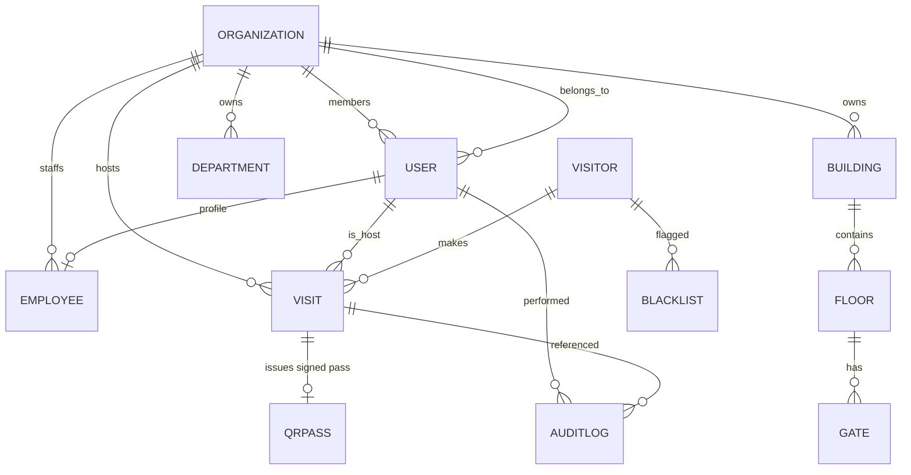
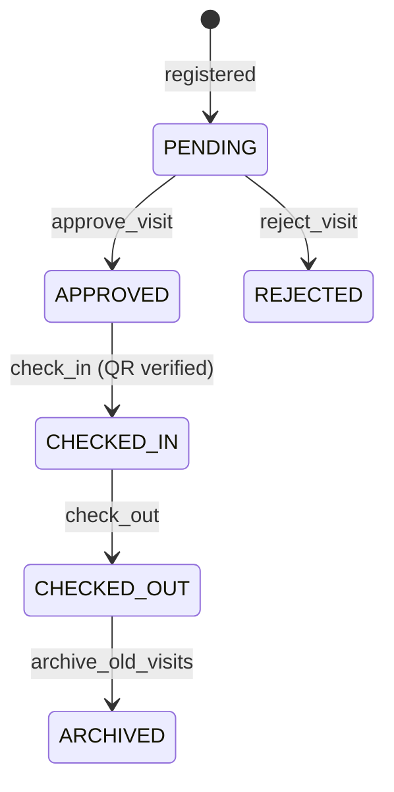

# SecureGate — Architecture & Design

## 1. High-level architecture

```
┌────────────────────────────────────────────────────────────┐
│  Browser (Django Templates + Bootstrap 5 + Chart.js)        │
│  Landing / Auth / Dashboards / Reception / Security / Admin │
└───────────────┬──────────────────────────────┬─────────────┘
                │ (session auth, CSRF)         │ (JWT Bearer)
┌───────────────▼──────────────────┐   ┌────────▼─────────────────┐
│  Django View Layer               │   │  DRF API (api app)       │
│  accounts / organizations /      │   │  serializers + viewsets  │
│  visits / reports                │   │  SimpleJWT auth          │
└───────────────┬──────────────────┘   └────────┬─────────────────┘
                │  calls the SAME service layer  │
┌───────────────▼────────────────────────────────┴──────────────┐
│  Service layer (visits/services.py)                           │
│  approve_visit / reject_visit / check_in / check_out          │
│  - single source of truth for workflow rules                  │
│  - writes AuditLog on every mutation                          │
└───────────────┬──────────────────────────────────────────────┘
                ▼
┌───────────────────────────────────────────────────────────────┐
│  ORM (Django) → SQLite / PostgreSQL                            │
│  Tables: User, Organization, Building, Floor, Gate, Department,│
│  Employee, Visitor, Visit, QRPass, Blacklist, AuditLog         │
└───────────────────────────────────────────────────────────────┘
```

Key design decision: **the React app and every API caller share one service layer**,
so a mobile app or kiosk can be added later without duplicating business rules.

## 2. Data model (ERD)

```
accounts.User ──┬──> organizations.Organization
                │     ├──< Building ──< Floor
                │     │          └──< Gate
                │     ├──< Department
                │     └──< Employee (1:1 with User)
                │
                └──  role: ADMIN | RECEPTIONIST | SECURITY

visits.Visitor ──< visits.Visit ──> organizations.Organization
       │              │  ├──> organizations.Building (nullable)
       │              │  ├──> User (host)      ── 1:1 ──> QRPass
       │              │  └──> User (created_by)
       │              │
       └──< Blacklist (active reason)

organizations.AuditLog  (user, action, entity, details, timestamp)
```

### Status machine (Visit)

```
Registered ──> PENDING ──> APPROVED ──> CHECKED_IN ──> CHECKED_OUT ──> ARCHIVED
                  │            │
                  └──> REJECTED┘

QR pass expiry is modeled on QRPass (expires_at / is_expired), not on the
Visit: a visit stays APPROVED when its pass lapses and can be issued a fresh
pass, so no Visit is ever transitioned to an "EXPIRED" status.
```

Transitions enforced in `visits/services.py` — each transition validates current state,
logs to AuditLog, and (on approval) issues a signed QRPass.

### Mermaid diagrams (render on GitHub)





## 3. QR pass security

A QR pass is **signed and bound to a visit** so it can't be forged or replayed:

```
payload     = "<visit_id>|<organization_id>|<token>"
signature   = HMAC-SHA256(SECRET_KEY, payload)
QR contents = "<token>|<signature>"
```

On scan, `QRPass.verify()` checks, in order:
1. **Signature** — must match recomputed HMAC (tamper detection)
2. **Existence** — unknown tokens rejected
3. **Single use** — `is_used` flag blocks duplicate entry
4. **Expiry** — time-boxed (default 120 min)

## 4. RBAC matrix

| Permission | Admin | Reception | Security |
|---|---|---|---|
| create_visitor | ✅ | ✅ | — |
| approve_visitor | ✅ | — | — |
| checkin_visitor | ✅ | — | ✅ |
| checkout_visitor | ✅ | — | ✅ |
| scan_qr | ✅ | — | ✅ |
| badge_print | ✅ | ✅ | — |
| manage_buildings | ✅ | — | — |
| manage_employees | ✅ | — | — |
| manage_users / roles | ✅ | — | — |
| view_reports | ✅ | ✅ | ✅ |
| view_audit_logs | ✅ | — | — |
| blacklist_visitor | ✅ | — | ✅ |

Implemented declaratively in `accounts/permissions.py`; exposed to templates via a
context processor (`perms`), and enforced in every view with a `_guard()` check.

### 4.1 Backend authorization vs. UI visibility

These are two different things, and the codebase keeps them separate on purpose.

**Backend authorization is the security boundary.** Every mutating endpoint
decides from the session or JWT alone:

| Layer | Mechanism |
|---|---|
| Console views | `_guard(request, "<permission>")` (visits), `_admin_guard(request)` (organizations), `can_manage_users(...)` |
| DRF API | `permission_classes = [require_permission("<permission>")]` via `CanApproveVisit`, `CanCheckIn`, `CanCheckOut`, `CanRegisterVisitor` |
| Default | `DEFAULT_PERMISSION_CLASSES = [IsAuthenticated]`; anything mutating overrides it |
| Tenancy | `organization=<caller's org>` or `has_tenant()` before the lookup — never `organization=None`, which compiles to `IS NULL` and would match every unassigned row |

**UI visibility is a rendering hint.** The SPA asks the server what the caller
may do and hides links it knows will fail:

```
GET /api/auth/me/  ->  { user, organization, permissions: [...] }
```

`permissions` is computed by `user_permissions()` — the *same* function the
guards use — so the client cannot present a permission the server would not
grant. The frontend then renders via `useAuth().can(perm)`, which **fails
closed**: the list is empty until `/me` responds.

What this buys, and what it does not:

* The role→feature matrix exists in exactly one place now. Previously
  `App.tsx` and `Sidebar.tsx` each carried their own hand-written role lists
  (`roles={["ADMIN", "RECEPTIONIST"]}` and `["ADMIN","RECEPTIONIST"].includes(r)`),
  which could drift: `/dashboard/reports` was ungated in the router while the
  sidebar gated it. Both now name the same permission, so they cannot disagree
  about who sees what.
* `Permission` in `frontend/src/lib/types.ts` is a *mirror* of the backend
  names, not a second source of truth. It exists so a typo in `can("...")` is a
  compile error instead of a permanently-false check. Adding a permission
  backend-side still requires adding it there — the mirror is a build-time
  tripwire, never a substitute for the server's check.

**The client is never trusted.** `CapabilitiesGrantNothingTests` in
`accounts/test_authorization_matrix.py` asserts this directly: a client that
POSTs `{"permissions": ["approve_visitor"]}`, sends `X-User-Role: ADMIN`, or
lies in any other field is still refused, because no view reads authorization
out of the request. If the `/me` list were wrong, tampered with, or absent, the
worst outcome would be a page showing the wrong links.

`ConsoleMutationAuthorizationTests` in the same file is the executable version
of the table above: one row per mutating endpoint, cross-checked against
`permissions.py` in
`test_the_table_agrees_with_the_permission_source_of_truth`, so a view that
widens or drops its guard fails the suite.

## 5. Security measures implemented

- **Passwords:** Argon2 (resists GPU cracking), bcrypt fallback
- **Auth:** JWT access/refresh with rotation + blacklisting, session auth for the web UI
- **Account lockout:** 5 failed attempts → 15 min lock. Enforced by
  `accounts.backends.LockoutBackend` on **every** login path (JWT API, console
  login, Django admin) so it cannot be bypassed via a different endpoint
- **QR forgery:** HMAC signature bound to secret + visit IDs
- **CSRF:** enabled on all web forms. Every state-changing view is additionally
  `@require_POST`, so a mutation cannot be reached by GET — which would exempt
  it from CSRF middleware entirely and make it fireable from a plain link
- **Blacklist:** enforced at approval AND check-in layers (defense in depth).
  Add and remove are deliberately asymmetric: SECURITY may add a ban, only
  ADMIN may lift one, so an officer cannot quietly let in someone they banned
- **Fail-closed UI:** sidebar and route gates default to "nothing permitted"
  until the server answers; no component assumes `ADMIN` when the user is
  unknown
- **Upload validation:** size ceilings plus a content check on visitor
  documents — extension allowlist *and* magic-byte sniffing, because an
  extension is attacker-controlled and a `passport.pdf` may be a web page
- **Private document storage:** identity documents live outside `MEDIA_ROOT`
  behind a storage backend with no `base_url`, so `.url` raises rather than
  publishing them. They are served only by `visits:document`, after a
  permission check and a tenant-scoped lookup, with an allowlisted
  `Content-Type`, `nosniff`, `Content-Disposition: attachment`,
  `Cache-Control: no-store` and an audit entry. Cross-tenant requests get a
  `404`, not a `403`, so the endpoint cannot be used to probe for records
- **Parameterized queries:** 100% ORM, no raw SQL
- **Audit logging:** every state-changing action is recorded immutably
- **Rate limiting:** SimpleJWT + DRF throttling configured for auth endpoints

## 6. What's designed but not built (honest roadmap)

Mention these as *future work*, not as things already done:

- Celery background jobs (email, QR expiry sweeps, nightly reports) — `archive_old_visits()`
  already exists as the unit of work to be scheduled
- Real email delivery (currently console backend), SMS / WhatsApp / push
- Facial recognition, OCR of ID cards, NFC/RFID, kiosk self-service
- PostgreSQL + Redis for production, Docker Compose + CI
- i18n, multi-language
